If you're looking for a specific solution to something, these are the hardware and software tools we recommend in a variety of categories. Our recommended privacy tools are primarily chosen based on security features, with additional emphasis on decentralized and open-source tools. They are applicable to a variety of threat models ranging from protection against global mass surveillance programs and avoiding big tech companies to mitigating attacks, but only you can determine what will work best for your needs.

[VPN Providers](vpn.md){ .md-button }
[Password Managers](passwords.md){ .md-button }
[Email Providers](email.md){ .md-button }
[Browser Extensions](browser-extensions.md){ .md-button }
[DNS Servers](dns.md){ .md-button }
[Email Aliasing Services](email-aliasing.md){ .md-button }
[Photo Organization Tools](photo-management.md){ .md-button }

[Self-hosting recommendations](self-hosting/index.md) have been moved to their own category.

If you want assistance figuring out the best privacy tools and alternative programs for your needs, start a discussion on our [forum](https://discuss.privacyguides.net) or our [Matrix](https://matrix.to/#/#privacyguides:matrix.org) community!

For more details about each project, why they were chosen, and additional tips or tricks we recommend, click the "Learn more" link in each section, or click on the recommendation itself to be taken to that specific section of the page.

- [x] **Ad-Free Recommendations**
- [x] **Frequent Updates**
- [x] **Trusted by Readers**

- [x] **Complete Editorial Independence**
- [x] **Open-Source Contributions**
- [x] **Trusted by Journalists**

## Private Web Browsers

{ align=left }

**Tor Browser** (Desktop & Android) is the top choice if you need anonymity, as it provides you with access to the **Tor** network, a group of volunteer-operated servers that allows you to connect for free and improve your privacy and security on the Internet. Individuals and organizations can also share information over the Tor network with ".onion hidden services" without compromising their privacy. Because Tor traffic is difficult to block and trace, Tor is an effective censorship circumvention tool.

[Read Our Full Review :material-arrow-right-drop-circle:](tor.md){ .md-button .md-button--primary }

- { .lg .middle .twemoji } **Mullvad Browser**

    ---

    **Mullvad Browser** is a version of [Tor Browser](tor.md#tor-browser) with Tor network integrations removed, aimed at providing Tor Browser's anti-fingerprinting browser technologies to VPN users.

    - [Read Full Review :material-arrow-right-drop-circle:](desktop-browsers.md#mullvad-browser)

- { .lg .middle .twemoji } **Firefox**

    ---

    **Firefox** is a great Chromium alternative which provides strong privacy settings such as [Enhanced Tracking Protection](https://support.mozilla.org/kb/enhanced-tracking-protection-firefox-desktop), which can help block various [types of tracking](https://support.mozilla.org/kb/enhanced-tracking-protection-firefox-desktop#w_what-enhanced-tracking-protection-blocks).

    - [Read Full Review :material-arrow-right-drop-circle:](desktop-browsers.md#firefox)

- { .lg .middle .twemoji } **Brave Browser**

    ---

    **Brave** is a private-by-default browser based on Chromium, so it should feel familiar and have minimal website compatibility issues.

    - [Brave Desktop Review :material-arrow-right-drop-circle:](desktop-browsers.md#brave)
    - [Brave Mobile Review :material-arrow-right-drop-circle:](mobile-browsers.md#brave)

- 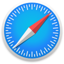{ .lg .middle .twemoji } **Safari (iOS)**

    ---

    We recommend **Safari** due to its [anti-fingerprinting](https://webkit.org/blog/15697/private-browsing-2-0) features and default tracker blocking. It also separates your cookies in private browsing mode to prevent tracking between tabs.

    - [Read Full Review :material-arrow-right-drop-circle:](mobile-browsers.md#safari-ios)

### Browser Extensions

- { .twemoji loading=lazy } [uBlock Origin](browser-extensions.md#ublock-origin)
- { .twemoji loading=lazy } [uBlock Origin Lite](browser-extensions.md#ublock-origin-lite)
- { .twemoji loading=lazy } [AdGuard for iOS](browser-extensions.md#adguard)

### More Tor Network Tools

- { .twemoji loading=lazy } [Onion Browser (Tor for iOS)](tor.md#onion-browser-ios)

## Top 3 Private VPN Providers

VPNs do not provide anonymity

Using a VPN will **not** keep your browsing habits anonymous, nor will it add additional security to non-secure (HTTP) traffic.

If you are looking for **anonymity**, you should use the Tor Browser.

If you're looking for added **security**, you should always ensure you're connecting to websites using HTTPS. A VPN is not a replacement for good security practices.

[Learn more :material-arrow-right-drop-circle:](vpn.md)

- { .lg .middle .twemoji } **Proton VPN**

    ---

    - [x] **112+ Countries**
    - [x] WireGuard Support
    - [x] Cash Payments
    - [x] Partial Port Forwarding Support
    - [ ] No IPv6

    [Read Full Review :material-arrow-right-drop-circle:](vpn.md#proton-vpn)

- { .lg .middle .twemoji } **IVPN**

    ---

    - [x] **37+ Countries**
    - [x] WireGuard Support
    - [x] Monero & Cash Payments
    - [ ] No Port Forwarding
    - [ ] No IPv6

    [Read Full Review :material-arrow-right-drop-circle:](vpn.md#ivpn)

- { .lg .middle .twemoji } **Mullvad**

    ---

    - [x] **49+ Countries**
    - [x] WireGuard Support
    - [x] Monero & Cash Payments
    - [ ] No Port Forwarding
    - [x] IPv6 Support

    [Read Full Review :material-arrow-right-drop-circle:](vpn.md#mullvad)

## Top 3 Private Email Providers

- { .lg .middle .twemoji } **Proton Mail**

    ---

    Proton Mail is an email service with a focus on privacy, encryption, security, and ease of use. They have been in operation since 2013. Proton AG is based in Geneva, Switzerland. The Proton Mail Free plan comes with 500 MB of Mail storage, which you can increase up to 1 GB for free.

    [Read Full Review :material-arrow-right-drop-circle:](email.md#proton-mail)

- { .lg .middle .twemoji } **Mailbox Mail**

    ---

    Mailbox Mail (formerly *Mailbox.org*) is an email service with a focus on being secure, ad-free, and powered by 100% eco-friendly energy. They have been in operation since 2014. Mailbox Mail is based in Berlin, Germany. Accounts start with up to 2 GB storage, which can be upgraded as needed.

    [Read Full Review :material-arrow-right-drop-circle:](email.md#mailbox-mail)

- { .lg .middle .twemoji }{ .lg .middle .twemoji } **Tuta**

    ---

    Tuta (formerly *Tutanota*) is an email service with a focus on security and privacy through the use of encryption. Tuta has been in operation since 2011 and is based in Hanover, Germany. Free accounts start with 1 GB of storage.

    [Read Full Review :material-arrow-right-drop-circle:](email.md#tuta)

### Email Aliasing Services

- 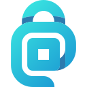{ .twemoji loading=lazy } [Addy.io](email-aliasing.md#addyio)
- { .twemoji loading=lazy } [SimpleLogin](email-aliasing.md#simplelogin)

### Secure Email Clients

- { .twemoji loading=lazy } [Thunderbird](email-clients.md#thunderbird)
- 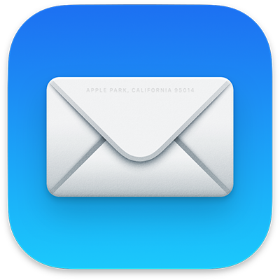{ .twemoji loading=lazy } [Apple Mail (macOS)](email-clients.md#apple-mail-macos)
- { .twemoji loading=lazy } [FairEmail (Android)](email-clients.md#fairemail-android)
- { .twemoji loading=lazy } [GNOME Evolution (Linux)](email-clients.md#gnome-evolution-gnome)
- { .twemoji loading=lazy } [Kontact (Linux)](email-clients.md#kontact-kde)
- { .twemoji loading=lazy } [Mailvelope (PGP in standard webmail)](email-clients.md#mailvelope-browser)
- 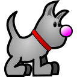{ .twemoji loading=lazy } [NeoMutt (CLI)](email-clients.md#neomutt-cli)

[Learn more :material-arrow-right-drop-circle:](email-clients.md)

## More Private Service Providers

### Cloud Storage

- { .twemoji loading=lazy } [Proton Drive](cloud.md#proton-drive)
- 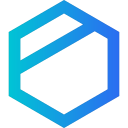{ .twemoji loading=lazy } [Tresorit](cloud.md#tresorit)
- 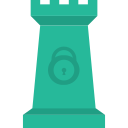{ .twemoji loading=lazy } [Peergos](cloud.md#peergos)

[Learn more :material-arrow-right-drop-circle:](cloud.md)

### Data Removal Services

- { .twemoji loading=lazy } [EasyOptOuts](data-broker-removals.md#easyoptouts-paid)
- { .twemoji loading=lazy } [Google *Results about you*](data-broker-removals.md#google-results-about-you-free)

[Learn more :material-arrow-right-drop-circle:](data-broker-removals.md)

### DNS

#### DNS Providers

We [recommend](dns.md#recommended-providers) a number of encrypted DNS servers based on a variety of criteria, such as [Quad9](https://quad9.net) amongst others. We recommend for you to read our pages on DNS before choosing a provider. In many cases, using an alternative DNS provider is not recommended.

[Learn more :material-arrow-right-drop-circle:](dns.md)

#### Encrypted DNS Proxies

- { .twemoji loading=lazy }{ .twemoji loading=lazy } [RethinkDNS](dns.md#rethinkdns)
- { .twemoji loading=lazy } [DNSCrypt-Proxy](dns.md#dnscrypt-proxy)

[Learn more :material-arrow-right-drop-circle:](dns.md#encrypted-dns-proxies)

### Financial Services

#### Payment Masking Services

- { .twemoji loading=lazy }{ .twemoji loading=lazy } [Privacy.com](financial-services.md#privacycom-us)
- { .twemoji loading=lazy }{ .twemoji loading=lazy } [MySudo](financial-services.md#mysudo-us-paid)

[Learn more :material-arrow-right-drop-circle:](financial-services.md#payment-masking-services)

#### Online Gift Card Marketplaces

- { .twemoji loading=lazy } [Coincards](financial-services.md#coincards)

[Learn more :material-arrow-right-drop-circle:](financial-services.md#gift-card-marketplaces)

### Photo Management

- { .twemoji loading=lazy } [Ente Photos](photo-management.md#ente-photos)

[Learn more :material-arrow-right-drop-circle:](photo-management.md)

### Search Engines

- { .twemoji loading=lazy } [Brave Search](search-engines.md#brave-search)
- { .twemoji loading=lazy } [DuckDuckGo](search-engines.md#duckduckgo)
- { .twemoji loading=lazy } [SearXNG](search-engines.md#searxng)
- { .twemoji loading=lazy }{ .twemoji loading=lazy } [Startpage](search-engines.md#startpage)

[Learn more :material-arrow-right-drop-circle:](search-engines.md)

## Software

### AI Chat

- { .twemoji loading=lazy } [Kobold.cpp](ai-chat.md#koboldcpp)
- { .twemoji loading=lazy } [Llamafile](ai-chat.md#llamafile)
- 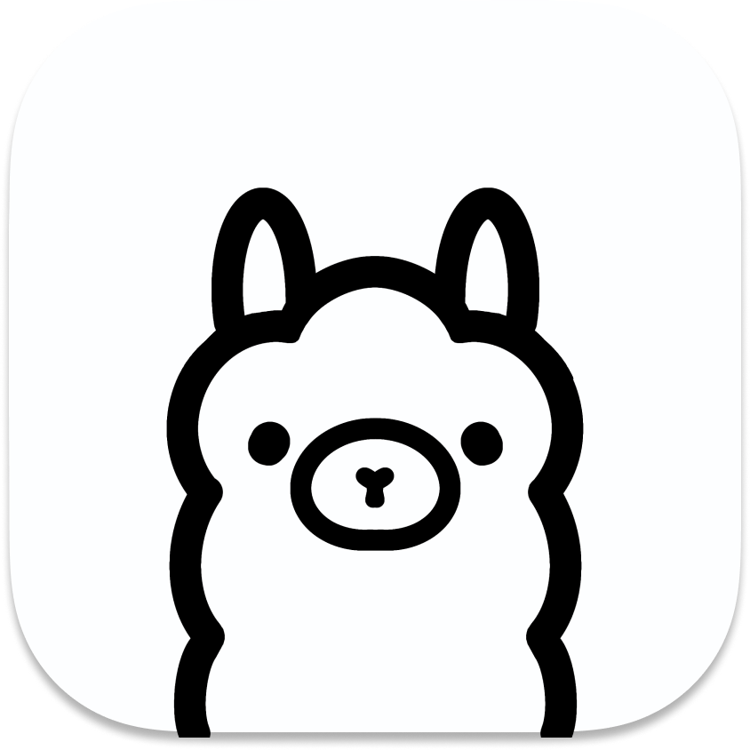{ .twemoji loading=lazy } [Ollama (CLI)](ai-chat.md#ollama-cli)

[Learn more :material-arrow-right-drop-circle:](ai-chat.md)

### Calendar Sync

- { .twemoji loading=lazy }{ .twemoji loading=lazy } [Tuta](calendar.md#tuta)
- 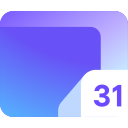{ .twemoji loading=lazy } [Proton Calendar](calendar.md#proton-calendar)

[Learn more :material-arrow-right-drop-circle:](calendar.md)

### Cryptocurrency

- { .twemoji loading=lazy } [Monero](cryptocurrency.md#monero)

[Learn more :material-arrow-right-drop-circle:](cryptocurrency.md)

### Data and Metadata Redaction

- { .twemoji loading=lazy } [MAT2](data-redaction.md#mat2)
- 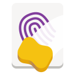{ .twemoji loading-lazy } [Metadata Cleaner](data-redaction.md#metadata-cleaner)
- { .twemoji loading=lazy } [ExifEraser (Android)](data-redaction.md#exiferaser-android)
- { .twemoji loading=lazy } [ExifTool (CLI)](data-redaction.md#exiftool-cli)

[Learn more :material-arrow-right-drop-circle:](data-redaction.md)

### Document Collaboration

- 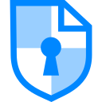{ .twemoji loading=lazy } [CryptPad](document-collaboration.md#cryptpad)

[Learn more :material-arrow-right-drop-circle:](document-collaboration.md)

### Encryption Software

Operating System Encryption

For encrypting your OS drive, we typically recommend using the encryption tool your operating system provides, whether that is **BitLocker** on Windows, **FileVault** on macOS, or **LUKS** on Linux. These tools are included with the operating system and take advantage of hardware encryption elements such as a [secure cryptoprocessor](basics/hardware.md/#tpmsecure-cryptoprocessor).

[Learn more :material-arrow-right-drop-circle:](encryption.md#operating-system-encryption)

#### Cross-Platform Tools

- { .twemoji loading=lazy } [Cryptomator](encryption.md#cryptomator-cloud)
- { .twemoji loading=lazy }{ .twemoji loading=lazy } [VeraCrypt (FDE)](encryption.md#veracrypt-disk)
- 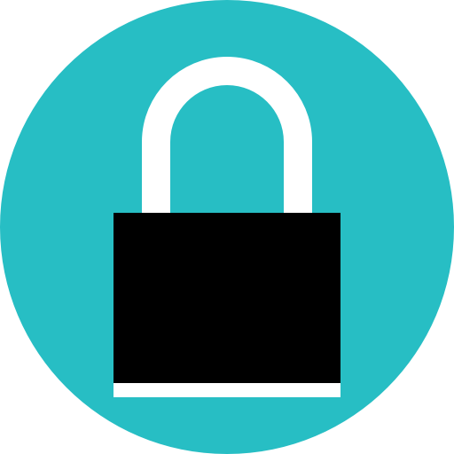{ .twemoji loading=lazy } [Kryptor](encryption.md#kryptor)
- { .twemoji loading=lazy } [Tomb](encryption.md#tomb)

[Learn more :material-arrow-right-drop-circle:](encryption.md)

#### OpenPGP Clients

- { .twemoji loading=lazy } [GnuPG](encryption.md#gnu-privacy-guard)
- 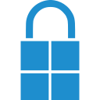{ .twemoji loading=lazy } [GPG4Win (Windows)](encryption.md#gpg4win)
- 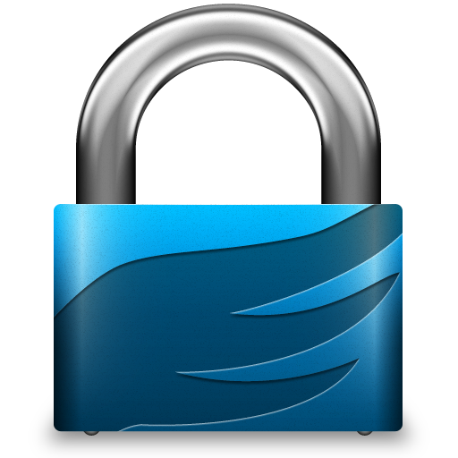{ .twemoji loading=lazy } [GPG Suite (macOS)](encryption.md#gpg-suite)
- { .twemoji loading=lazy } [OpenKeychain](encryption.md#openkeychain)

[Learn more :material-arrow-right-drop-circle:](encryption.md#openpgp)

### File Sharing and Sync

- { .twemoji loading=lazy } [Send](file-sharing.md#send)
- { .twemoji loading=lazy } [OnionShare](file-sharing.md#onionshare)
- 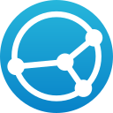{ .twemoji loading=lazy } [Syncthing](file-sharing.md#syncthing-p2p)

[Learn more :material-arrow-right-drop-circle:](file-sharing.md)

### Frontends

- { .twemoji loading=lazy } [Redlib (Reddit, Web)](frontends.md#redlib)
- { .twemoji loading=lazy } [FreeTube (YouTube, Desktop)](frontends.md#freetube)
- { .twemoji loading=lazy }{ .twemoji loading=lazy } [LibreTube (YouTube, Android)](frontends.md#libretube-android)
- { .twemoji loading=lazy } [NewPipe (YouTube, Android)](frontends.md#newpipe-android)
- { .twemoji loading=lazy }{ .twemoji loading=lazy } [Invidious (YouTube, Web)](frontends.md#invidious)
- { .twemoji loading=lazy } [Piped (YouTube, Web)](frontends.md#piped)

[Learn more :material-arrow-right-drop-circle:](frontends.md)

### Health and Wellness Apps

- 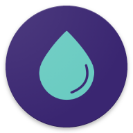{ .twemoji loading=lazy } [Drip](health-and-wellness.md#drip)
- 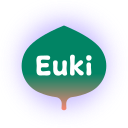{ .twemoji loading=lazy } [Euki](health-and-wellness.md#euki)
- { .twemoji loading=lazy } { .twemoji loading=lazy } [Apple Health](health-and-wellness.md#apple-health)
- 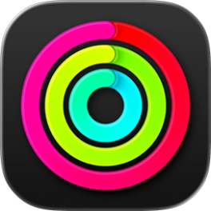{ .twemoji loading=lazy } [Apple Fitness](health-and-wellness.md#apple-fitness)
- { .twemoji loading=lazy }{ .twemoji loading=lazy } [Gadgetbridge](health-and-wellness.md#gadgetbridge)
- { .twemoji loading=lazy } { .twemoji loading=lazy } [Apple Health Records](health-and-wellness.md#apple-health-records)
- 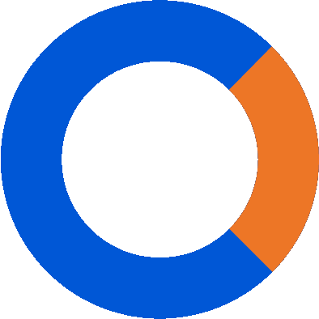{ .twemoji loading=lazy } [CommonHealth](health-and-wellness.md#commonhealth)

[Learn more :material-arrow-right-drop-circle:](health-and-wellness.md)

### Language Tools

- { .twemoji } [LibreTranslate](language-tools.md#libretranslate)

[Learn more :material-arrow-right-drop-circle:](language-tools.md)

### Maps and Navigation Apps

- { .twemoji loading=lazy } [Organic Maps](maps.md#organic-maps)
- 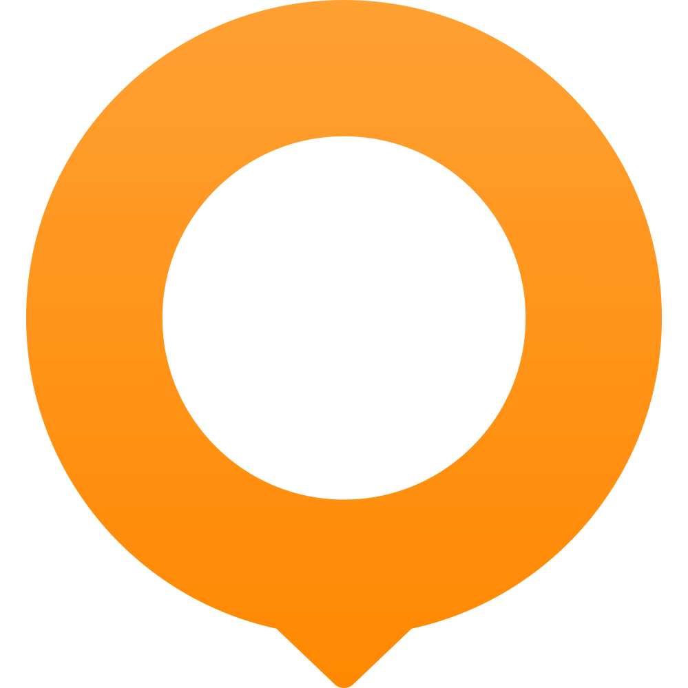{ .twemoji loading=lazy } [OsmAnd](maps.md#osmand)

[Learn more :material-arrow-right-drop-circle:](maps.md)

### Multi-Factor Authentication Tools

**Note:** [Hardware security keys](#security-keys) have been moved to their own category.

- 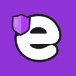{ .twemoji loading=lazy } [Ente Auth](multi-factor-authentication.md#ente-auth)
- 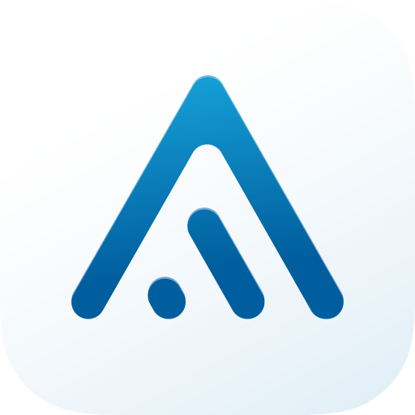{ .twemoji loading=lazy } [Aegis Authenticator (Android)](multi-factor-authentication.md#aegis-authenticator-android)

[Learn more :material-arrow-right-drop-circle:](multi-factor-authentication.md)

### News Aggregators

- { .twemoji loading=lazy } [Akregator](news-aggregators.md#akregator)
- { .twemoji loading=lazy } [NewsFlash](news-aggregators.md#newsflash)
- 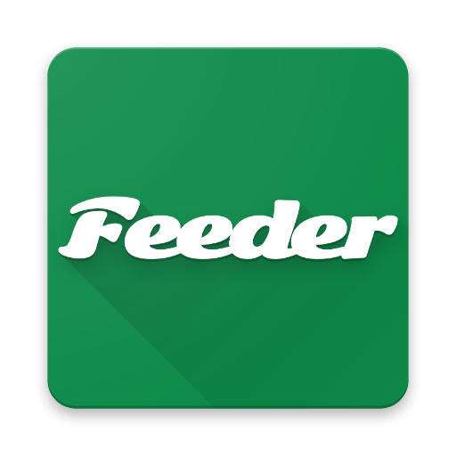{ .twemoji} [Feeder (Android)](news-aggregators.md#feeder)
- { .twemoji loading=lazy }{ .twemoji loading=lazy } [Miniflux](news-aggregators.md#miniflux)
- 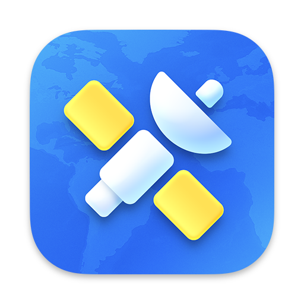{ .twemoji loading=lazy } [NetNewsWire](news-aggregators.md#netnewswire)
- { .twemoji loading=lazy } [Newsboat](news-aggregators.md#newsboat)

[Learn more :material-arrow-right-drop-circle:](news-aggregators.md)

### Notebooks

- { .twemoji loading=lazy } [Standard Notes](notebooks.md#standard-notes)
- { .twemoji loading=lazy } [Notesnook](notebooks.md#notesnook)
- { .twemoji loading=lazy } [Joplin](notebooks.md#joplin)
- { .twemoji loading=lazy }{ .twemoji loading=lazy } [Cryptee](notebooks.md#cryptee)
- 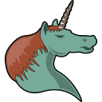{ .twemoji loading=lazy } [Org-mode](notebooks.md#org-mode)

[Learn more :material-arrow-right-drop-circle:](notebooks.md)

### Office Suites

- { .twemoji loading=lazy } [LibreOffice](office-suites.md#libreoffice)
- { .twemoji loading=lazy } [OnlyOffice](office-suites.md#onlyoffice)

[Learn more :material-arrow-right-drop-circle:](office-suites.md)

### Password Managers

- { .twemoji loading=lazy } [Bitwarden](passwords.md#bitwarden)
- 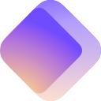{ .twemoji loading=lazy } [Proton Pass](passwords.md#proton-pass)
- 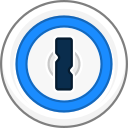{ .twemoji loading=lazy } [1Password](passwords.md#1password)
- 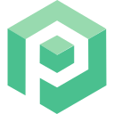{ .twemoji loading=lazy } [Psono](passwords.md#psono)
- { .twemoji loading=lazy } [KeePassXC](passwords.md#keepassxc)
- 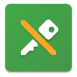{ .twemoji loading=lazy } [KeePassDX (Android)](passwords.md#keepassdx-android)
- 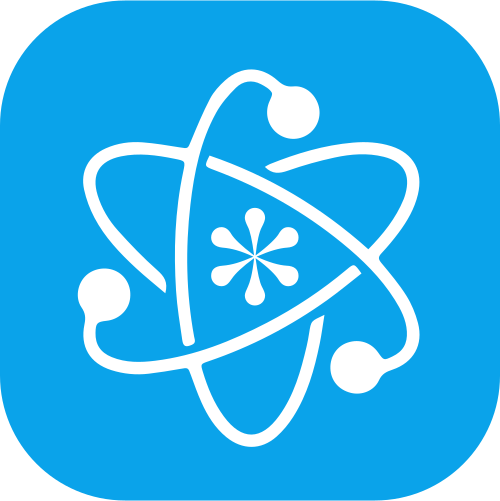{ .twemoji loading=lazy } [KeePassium (iOS & macOS)](passwords.md#keepassium-ios-macos)
- 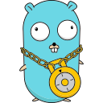{ .twemoji loading=lazy } [Gopass (CLI)](passwords.md#gopass-cli)

[Learn more :material-arrow-right-drop-circle:](passwords.md)

### Pastebins

- { .twemoji loading=lazy } [PrivateBin](pastebins.md#privatebin)
- { .twemoji loading=lazy } [Paaster](pastebins.md#paaster)

[Learn more :material-arrow-right-drop-circle:](pastebins.md)

### Real-Time Communication

- 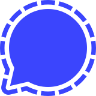{ .twemoji loading=lazy } [Signal](real-time-communication.md#signal)
- { .twemoji loading=lazy } [Briar](real-time-communication.md#briar)
- { .twemoji loading=lazy } [SimpleX Chat](real-time-communication.md#simplex-chat)

[Learn more :material-arrow-right-drop-circle:](real-time-communication.md)

### Social Networks

- { .twemoji loading=lazy } [Mastodon](social-networks.md#mastodon)
- 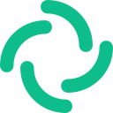{ .twemoji loading=lazy } [Element](social-networks.md#element)

[Learn more :material-arrow-right-drop-circle:](social-networks.md)

## Hardware

### Security Keys

- { .twemoji loading=lazy } [Yubico Security Key](security-keys.md#yubico-security-key)
- { .twemoji loading=lazy } [YubiKey](security-keys.md#yubikey)
- 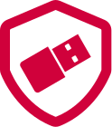{ .twemoji loading=lazy } [Nitrokey](security-keys.md#nitrokey)

[Learn more :material-arrow-right-drop-circle:](security-keys.md)

### Mobile Phones

- { .twemoji loading=lazy } [Google Pixel](mobile-phones.md#google-pixel)

[Learn more :material-arrow-right-drop-circle:](mobile-phones.md)

## Operating Systems

### Mobile

#### Custom Android Operating Systems

- { .twemoji loading=lazy }{ .twemoji loading=lazy } [GrapheneOS](android/distributions.md#grapheneos)

[Learn more :material-arrow-right-drop-circle:](android/distributions.md)

#### Android Apps

- { .twemoji loading=lazy } [Shelter (Work Profiles)](android/general-apps.md#shelter)
- { .twemoji loading=lazy }{ .twemoji loading=lazy } [Secure Camera](android/general-apps.md#secure-camera)
- { .twemoji loading=lazy }{ .twemoji loading=lazy } [Secure PDF Viewer](android/general-apps.md#secure-pdf-viewer)

[Learn more :material-arrow-right-drop-circle:](android/general-apps.md)

#### Ways to Obtain Android Apps

- { .twemoji loading=lazy } [Obtainium (App Manager)](android/obtaining-apps.md#obtainium)
- 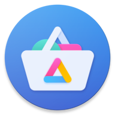{ .twemoji loading=lazy } [Aurora Store (Google Play Client)](android/obtaining-apps.md#aurora-store)

[Learn more :material-arrow-right-drop-circle:](android/obtaining-apps.md)

### Desktop/PC

- 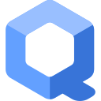{ .twemoji loading=lazy } [Qubes OS (Xen VM Distribution)](desktop.md#qubes-os)
- { .twemoji loading=lazy } [Fedora Linux](desktop.md#fedora-linux)
- 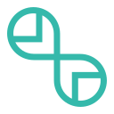{ .twemoji loading=lazy } [openSUSE Tumbleweed](desktop.md#opensuse-tumbleweed)
- 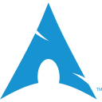{ .twemoji loading=lazy } [Arch Linux](desktop.md#arch-linux)
- { .twemoji loading=lazy } [Fedora Atomic Desktops](desktop.md#fedora-atomic-desktops)
- 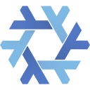{ .twemoji loading=lazy } [NixOS](desktop.md#nixos)
- { .twemoji loading=lazy } [Whonix (Tor)](desktop.md#whonix)
- 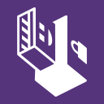{ .twemoji loading=lazy } [Tails (Live Boot)](desktop.md#tails)
- 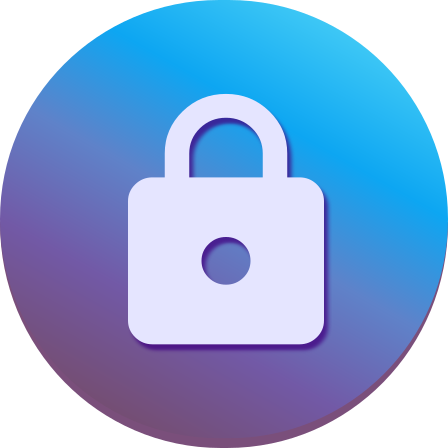{ .twemoji loading=lazy } [Secureblue](desktop.md#secureblue)
- 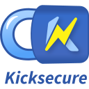{ .twemoji loading=lazy } [Kicksecure](desktop.md#kicksecure)

[Learn more :material-arrow-right-drop-circle:](desktop.md)

### Router Firmware

- { .twemoji loading=lazy }{ .twemoji loading=lazy } [OpenWrt](router.md#openwrt)
- { .twemoji loading=lazy } [OPNsense](router.md#opnsense)

[Learn more :material-arrow-right-drop-circle:](router.md)

## Advanced Tools

These tools may provide utility for certain individuals. They provide functionality which most people do not need to worry about, and often require more in-depth technical knowledge to utilize effectively.

### Alternative Networks

- { .twemoji loading=lazy } { .twemoji loading=lazy } [I2P](alternative-networks.md#i2p-the-invisible-internet-project)
- { .twemoji loading=lazy } [Tor](alternative-networks.md#tor)
- { .twemoji loading=lazy } [Orbot (Mobile Tor Proxy)](alternative-networks.md#orbot)
- { .twemoji loading=lazy }{ .twemoji loading=lazy } [Snowflake](alternative-networks.md#snowflake)

[Learn more :material-arrow-right-drop-circle:](alternative-networks.md)

### Device Integrity Verification

- { .twemoji loading=lazy }{ .twemoji loading=lazy } [Mobile Verification Toolkit](device-integrity.md#mobile-verification-toolkit)
- 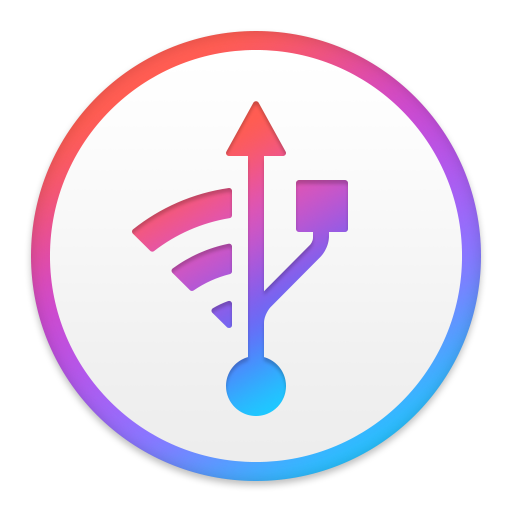{ .twemoji loading=lazy } [iMazing (iOS)](device-integrity.md#imazing-ios)
- { .twemoji loading=lazy }{ .twemoji loading=lazy } [Auditor (Android)](device-integrity.md#auditor-android)

[Learn more :material-arrow-right-drop-circle:](device-integrity.md)
